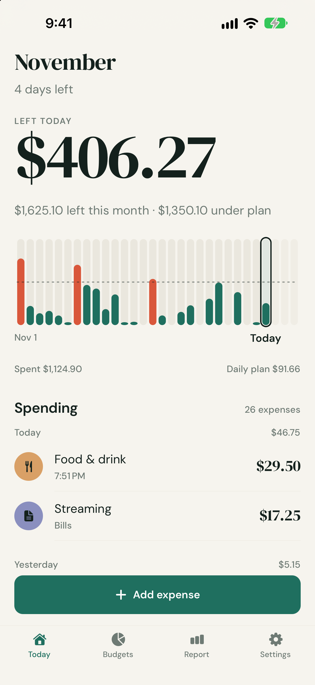
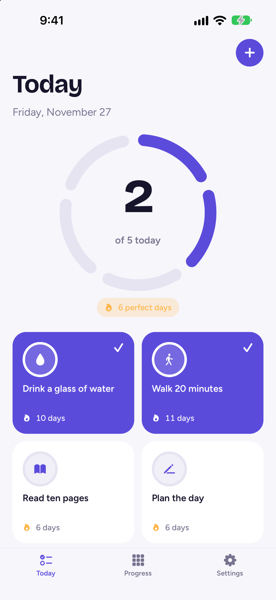
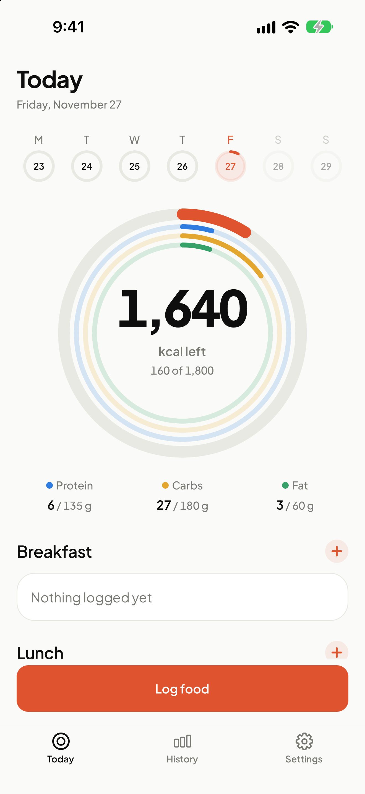
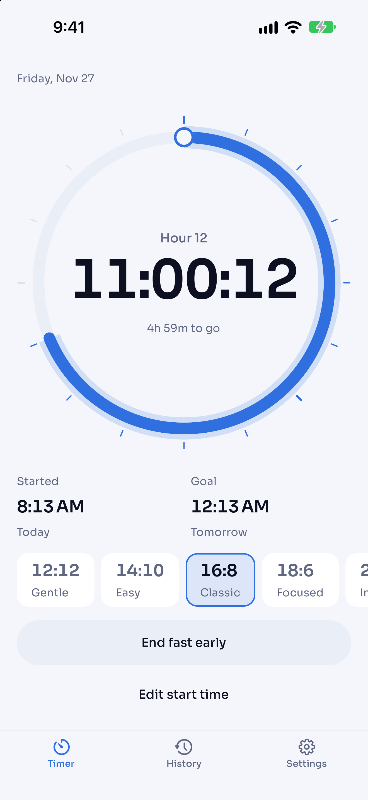
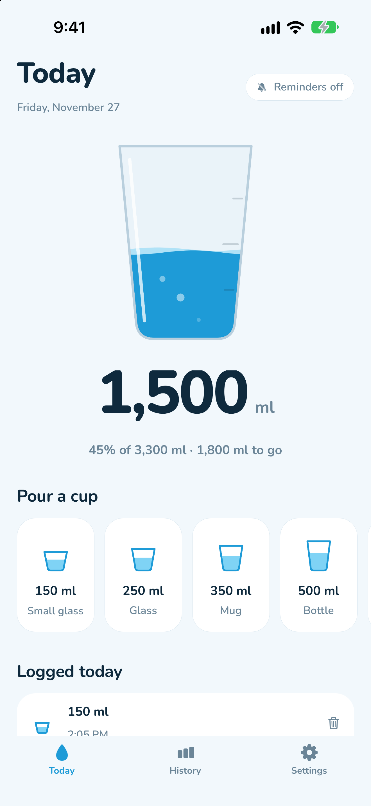
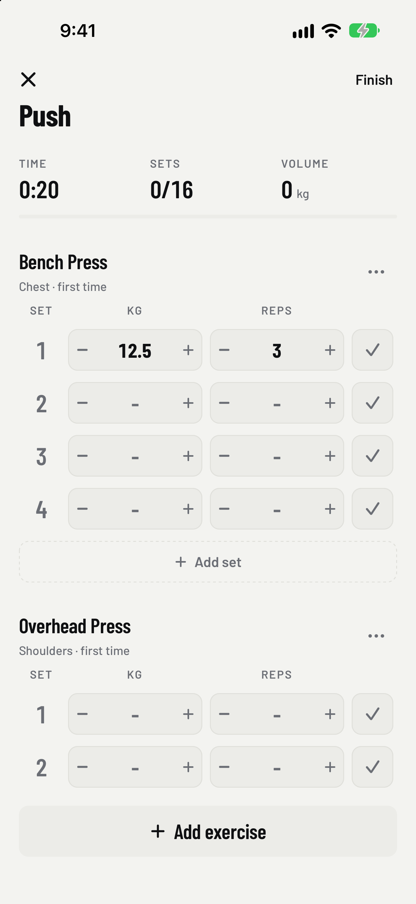
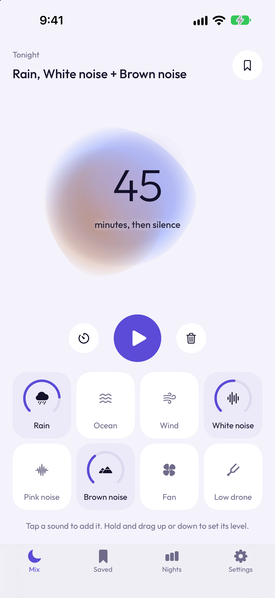
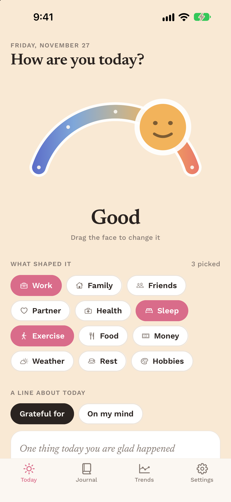
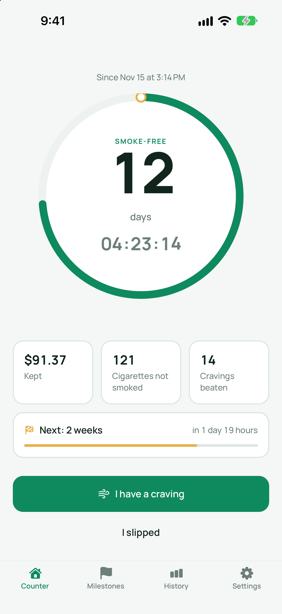
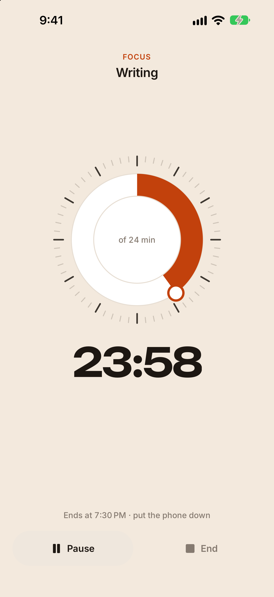

# Benji's App Starter · app templates

Ten ready-made iPhone apps in niches that already make money, plus the base they are built on.
Each one is a complete Expo app: onboarding that personalizes the app, a hard paywall wired for
RevenueCat, and the core feature, with local storage and no backend. Pick one, rebrand it with your
AI coding tool, put in your RevenueCat key and ship it.

For members of Benji's App Starter. See [LICENSE.md](LICENSE.md) before you use the code.

| | App | Niche | What makes it feel good |
|---|---|---|---|
|  | [Tallyo](expense-tracker) | Budget and expense tracker | A big "left today" number over a month runway; add expenses on a built-in keypad |
|  | [Daily Dots](habit-tracker) | Habit tracker | Press and hold a habit to fill its ring; a year grid per habit |
|  | [BiteCount](calorie-counter) | Calorie counter | Calories-left ring with protein, carbs and fat rings that move on every log |
|  | [Lean Hours](fasting-timer) | Intermittent fasting timer | Hold to start a fast; the ring lights hour by hour and turns gold at the goal |
|  | [Sipwell](water-reminder) | Water reminder | A glass that fills with a moving wave as you pour a cup |
|  | [Setlog](workout-log) | Workout log | A fast set table with steppers, a rest timer that drains, PR badges |
|  | [Nightmix](sleep-sounds) | Sleep sounds | Mix eight sounds; a slow blob takes the colors of the mix; a fade-out dial |
|  | [Daymood](mood-journal) | Mood journal | Drag a face along a color arc and the screen tints to the mood; a year in pixels |
|  | [Clearstreak](quit-habit) | Quit smoking / vaping / drinking | A live counter that rolls every second, money kept, a breathing circle for cravings |
|  | [Deepflow](focus-timer) | Focus timer | Turn a kitchen-timer dial to set the minutes; it unwinds while you work |

`base/` is the shared starting point (onboarding, paywall, tabs, theme, local database, rebrand
script) if you want to build a niche that is not on the list. `CONTRACT.md` lists the rules every
template follows, so they all work the same way.

## Start in five minutes

```bash
cd sleep-sounds            # or any app folder
npm install
npx expo start             # press i for the iOS simulator
```

Everything runs without any keys: the paywall uses a built-in mock purchase so you can click
through the whole app. Each app's README covers the rest:

1. **Rebrand**: `node scripts/rebrand.mjs --name "Your App" --slug your-app --bundle com.you.yourapp --color "#RRGGBB"`,
   then paste the AI rebrand prompt from the README into Claude Code, Cursor or Codex.
2. **Charge**: create the products and the `pro` entitlement in RevenueCat, copy `.env.example`
   to `.env` and add your key. Run `npx expo run:ios` to test real purchases (Expo Go always uses the mock).
3. **Ship**: build with EAS, submit to App Store Connect, and follow the Starter's two-week plan.

Each app's `README.md` explains why the niche makes money, with sources, the screens, the
paywall pricing it uses, and ideas for version two. `DESIGN-NOTES.md` has the palette, type scale and
how the signature interaction is built. `AGENTS.md` is the short guide your AI coding tool reads first.

## Stack

Expo SDK 58, React Native 0.88, TypeScript (strict), Expo Router, RevenueCat
(`react-native-purchases` + `react-native-purchases-ui`), expo-sqlite and AsyncStorage for data,
react-native-svg and Reanimated for the visuals, SF Symbols via expo-symbols. No backend, no account,
no analytics SDK: add the ones you want.

Questions go in the Starter Discord.
