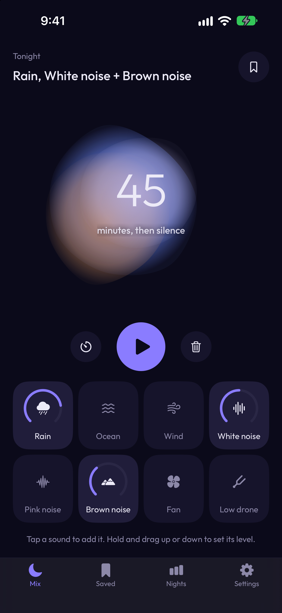
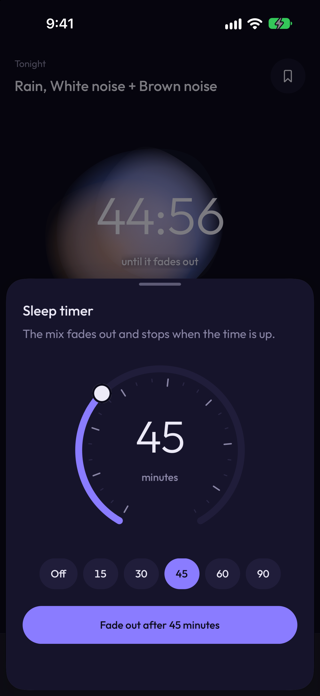
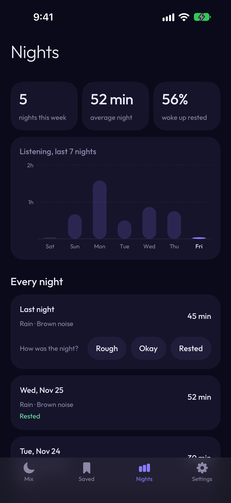

# Nightmix

A sleep-sounds app: mix rain, noise and low tones at your own levels, set a timer that fades the
room to silence, save the mixes that work, and keep a simple log of your nights. For anyone who
falls asleep to sound: light sleepers, people in loud flats, parents, shift workers. Everything
runs on the device, with eight bundled loops and no account.

  

## Why this niche

Sleep sounds are the richest wellness category after calorie counting: Calm takes about $940K a
week [2] and BetterSleep about $500K a month [3], with the white-noise category averaging $301K a
month per app [4]. Two apps take most of it, so a new entrant wins on a lane (baby sleep, focus
noise, tinnitus, a particular culture or language) with a tight mixer at $39.99 a year, a price

| App | Price (US App Store, Nov 27 2026) | Paywall |
|---|---|---|
| Calm | $14.99–16.99/mo, $69.99–79.99/yr; $69.99 sleep-only tier | Soft, 7-day trial after the quiz |
| BetterSleep | $11.99–99.99 IAPs, Individual/Duo/Family | "Start your free trial tonight", library behind a 7-day trial, 6–8 sounds free |
| Hatch Sleep | #25 Top Free Health & Fitness | Hardware companion |
| Category pattern | $9.99–14.99/mo, $39.99–69.99/yr | Soft, 7-day trial after a quiz |

Sources: [1] research/NICHES.md §7 in the templates repo, [2] Sensor Tower Q4 2025 Health &
Fitness revenue, [3] Adapty paywall library (BetterSleep, Oct 2026), [4] ScreensDesign white-noise
category. Nightmix keeps the hard paywall from the starter contract; the trial copy on it matches
the category's 7-day pattern.

## What is in the app

- **Onboarding** (5 steps): what you want help with, which sounds relax you, how long you take to
  fall asleep; the last step shapes your first mix and timer from the answers.
- **Paywall**: the mix you just built in its ready state, four benefits, weekly and yearly plans
  with the per-week price and saving computed from the store prices, a trial timeline, one CTA.
  Hard paywall; RevenueCat Paywalls can replace it with one setting.
- **Mix** tab: a breathing blob that takes the colors of the sounds in the mix; the sleep timer in
  its centre; play/pause; eight sound tiles. Tap a tile to add a sound, hold and drag to set its
  level on the arc around the icon. The mix plays in the background and in silent mode.
- **Sleep timer**: a dial you drag, five-minute clicks, quick picks, and a fade-out whose length
  is a setting. When it ends the mix falls silent and the night is logged.
- **Saved** tab: name a mix and start the same night again with one tap.
- **Nights** tab: minutes listened over the last seven nights, three numbers, every night with a
  one-tap "how was the night" rating.
- **Settings**: default sleep timer, fade-out length, clear data, plus the base rows (restore,
  manage subscription, terms, privacy, rate, contact, version). In development: load sample data,
  reset app.

The eight loops (rain, ocean, wind, white, pink and brown noise, fan, low drone) are synthesized by
`scripts/make-sounds.sh` with ffmpeg: 24-second seamless mono AAC files, about 200 KB each, no
licence to clear. Re-run the script to change them.

Stack: Expo SDK 58, Expo Router, TypeScript, React Native StyleSheet, expo-audio, react-native-svg,
Reanimated, Gesture Handler, RevenueCat, expo-sqlite.

## Run it

You need a Mac with [Xcode](https://apps.apple.com/app/xcode/id497799835) and Node 22.

```bash
npm install
npx expo run:ios
```

The app needs a development build (not Expo Go) for RevenueCat and background audio. Without a
RevenueCat key it uses the built-in paywall and a mock purchase, so you can click through
onboarding → paywall → tabs right away. In Settings there is a "Reset app" row (development only) to
go back to the first launch, and "Load sample data" to fill the Saved and Nights tabs.

## Connect RevenueCat

1. Create a project at [app.revenuecat.com](https://app.revenuecat.com) and add your iOS app
   (bundle id must match `ios.bundleIdentifier` in `app.json`).
2. In App Store Connect create two auto-renewable subscriptions (weekly and yearly) in one
   subscription group. Give the yearly one a 7-day free introductory offer, which is what the
   paywall promises (`trialDays` in `src/config/paywall.ts`; change both together). Add both
   products to RevenueCat.
3. In RevenueCat create an entitlement with the identifier `pro` and attach both products.
4. Create an offering and make it the **default**. Add two packages: **Weekly** (`$rc_weekly`)
   and **Annual** (`$rc_annual`) and attach the matching products.
5. Copy the iOS public API key (starts with `appl_`) and put it in a `.env` file:

   ```bash
   cp .env.example .env
   # EXPO_PUBLIC_REVENUECAT_IOS_KEY=appl_xxx
   ```

6. Rebuild: `npx expo run:ios`. The built-in paywall now shows the real prices and purchases are
   real (sandbox while testing).

Prefer a paywall designed in RevenueCat? Design and publish one for the offering, then set
`ui: 'revenuecat'` in `src/config/paywall.ts`.

## Rebrand

One command renames the app, slug, bundle id and brand color:

```bash
node scripts/rebrand.mjs --name "Lullr" --slug lullr --bundle com.yourname.lullr --color "#3B2F8F"
```

Then replace the images in `assets/` (`icon.png` 1024×1024, `splash-icon.png`, and the three
Android icon layers) and edit `src/config/app.ts` (support email, terms and privacy URLs). The
accent colors live in `src/theme/theme.ts` (`darkTheme` and `lightTheme`); the sound tints in
`src/features/mixer/sounds.ts`.

### Prompt for Claude Code or Cursor

Paste this into your AI coding agent, in the app folder, and fill in the angle brackets:

> Rebrand this sleep-sounds app for `<your lane, e.g. baby sleep / focus noise / tinnitus>`.
> Read README.md, AGENTS.md and DESIGN-NOTES.md first.
> 1. Run `node scripts/rebrand.mjs --name "<App Name>" --slug <app-slug> --bundle <com.company.app> --color "<#hex>"`.
> 2. Rewrite the copy in `src/config/onboarding.ts` for `<lane>` users. Keep five steps and the three question ids (`goal`, `sounds`, `fallAsleepTime`), because `src/features/mixer/plan.ts` turns them into the first mix; change the option ids there and in `plan.ts` together.
> 3. Rewrite the copy in `src/config/paywall.ts` (headline, subheadline, four benefits). Keep the plan ids, package ids and the `trialDays` that matches the store product.
> 4. Set the support email and legal URLs in `src/config/app.ts`.
> 5. Adjust the sound library in `src/features/mixer/sounds.ts` and `scripts/make-sounds.sh` for `<lane>` (names, tints, which loops ship). Keep every file a seamless mono AAC loop.
> 6. Keep the palette and typeface from DESIGN-NOTES.md unless I say otherwise; change the accent only through the rebrand script.
> 7. Finish with `npx tsc --noEmit`, `npx expo-doctor` and `npx expo export --platform ios`, all clean. No TODOs, placeholder text or unused code.

## Ship it

1. Create an [Apple Developer](https://developer.apple.com/programs/) account ($99/year) and an
   [Expo](https://expo.dev) account.
2. Install EAS: `npm install -g eas-cli`, then `eas login` and `eas build:configure`.
3. Put your RevenueCat key in EAS so the production build has it:
   `eas env:create --name EXPO_PUBLIC_REVENUECAT_IOS_KEY --value appl_xxx --environment production`
4. Build: `eas build --platform ios --profile production`. EAS creates the certificates for you.
   The build has the audio background mode (from the `expo-audio` plugin in `app.json`), so the
   mix keeps playing with the screen off.
5. In [App Store Connect](https://appstoreconnect.apple.com) create the app with the same
   bundle id, fill in the listing (screenshots, description, privacy policy URL, the two
   subscriptions), then `eas submit --platform ios` uploads the build.
6. Test the paywall with a Sandbox tester account, then submit for review. Apple asks for a
   terms-of-use link in the app description for subscription apps; `src/config/app.ts` holds
   the same URL used inside the app.

## Folder map

```
app/                      Routes. Thin files that render a screen from src/features.
  _layout.tsx             Root: loads the font, hydrates state, onboarding → paywall → tabs
  paywall.tsx             RevenueCat paywall, or the built-in one
  timer.tsx, save-mix.tsx Form sheets: the sleep-timer dial, naming a mix
  (onboarding)/           index (step 0) and [step] (1..4)
  (tabs)/                 index (Mix), saved, nights, settings
src/
  components/             Screen, Button, Card, Chip, CountUp, EmptyState, Icon, ListRow,
                          NightIllustration, ProgressBar, Text
  config/                 app.ts (email, links, entitlement), onboarding.ts, paywall.ts
  db/                     index.ts (open + migrate), migrations.ts, mixes.ts, sessions.ts, sample.ts
  features/
    mixer/                Blob (hero), engine (expo-audio players, timer, fade, session log),
                          MixScreen, SoundTile, TimerDial, TimerSheet, SaveMixSheet, plan, sounds
    saved/                SavedScreen
    nights/               NightsScreen, NightsChart
    onboarding/           OnboardingScreen
    paywall/              CustomPaywall, pricing
    settings/             SettingsScreen
  purchases/              getEntitlement / purchase / restore; RevenueCat or mock behind it
  state/appState.ts       Persisted store: onboardingDone, answers, entitled, timer, fade
  theme/theme.ts          Palette (dark and light), type scale, spacing, radii; useTheme()
scripts/rebrand.mjs       Rename app, slug, bundle id, brand color
scripts/make-sounds.sh    Regenerate the eight loops with ffmpeg
assets/                   Icon, splash image, Android icon layers, sounds/
screenshots/              The screens in light and dark
```

## Checks and notes

```bash
npx tsc --noEmit                 # types
npx expo-doctor                  # dependencies and config
npx expo export --platform ios   # the app bundles
```

Notes:

- Data tables: `mixes` (name, sounds with levels, timer) and `sessions` (a night: start, end,
  timer, sounds, rating). A stretch under one minute is not logged.
- The sleep timer runs on wall-clock time, so it still ends correctly if iOS paused the JavaScript
  timers while the screen was off.
- `expo-notifications` is installed but not used, so a bedtime reminder can be added without a
  new native dependency. `react-dom` is pinned only to satisfy Expo Router's dependency tree with
  npm; the app has no web target. `expo-dev-client` is there for the development build.
- `supportsTablet` is `false`, so App Store Connect only asks for iPhone screenshots.

## Ideas for version two

From the research's "leave out of version one" list and the owner's lane advice:

- A bedtime reminder (the onboarding bedtime question is easy to add; `expo-notifications` is ready).
- Lock-screen controls for the mix (`setActiveForLockScreen` on one player as the controller).
- A lane pack: baby sleep (shushing, heartbeat, womb), focus noise, or tinnitus-masking tones.
  moats; they cost far more than they return at this price.
