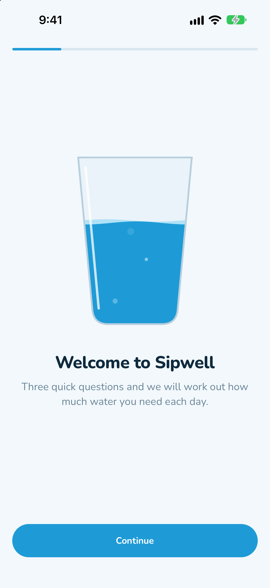
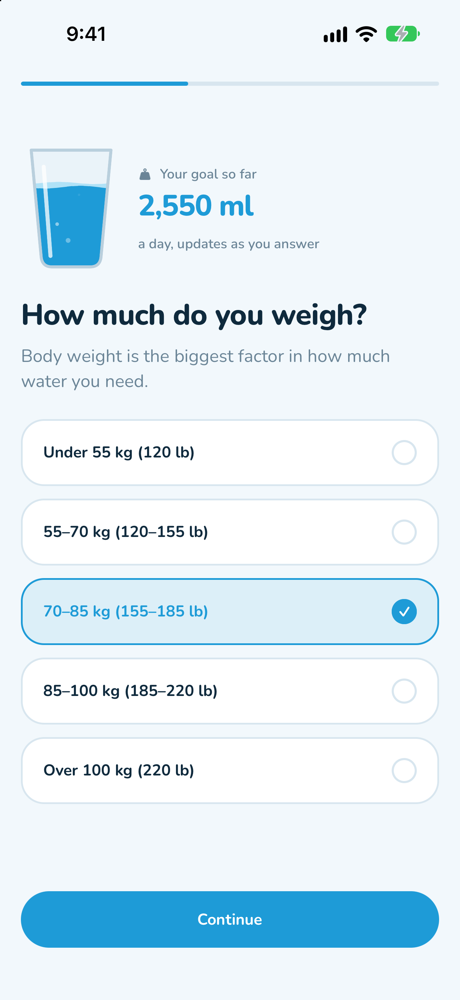
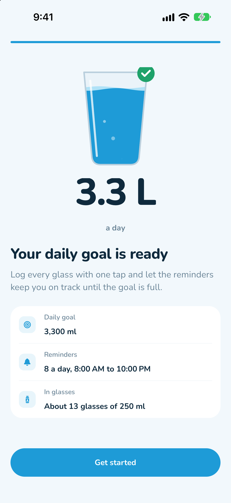
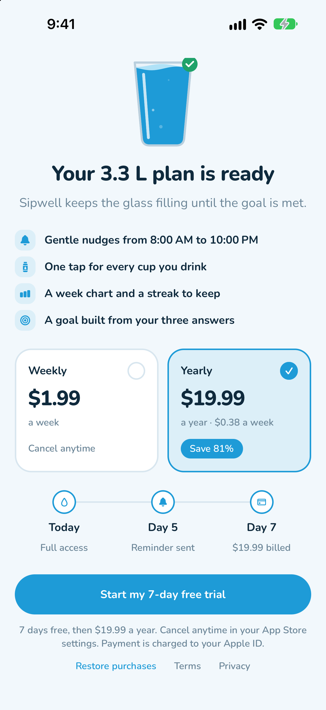
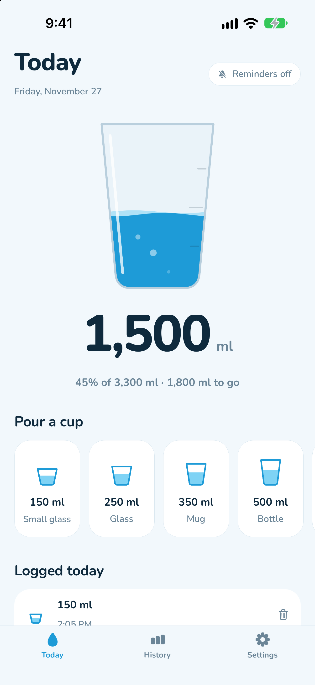
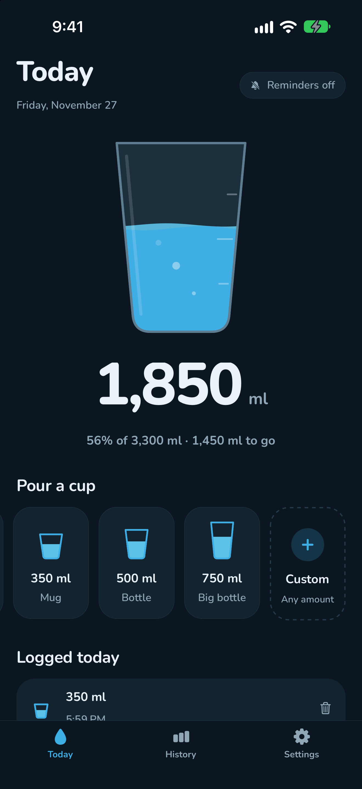
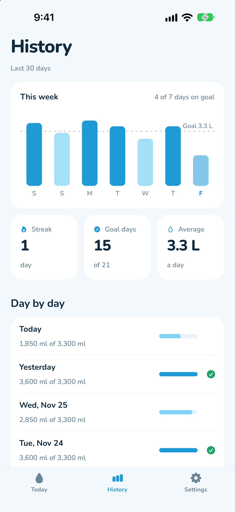
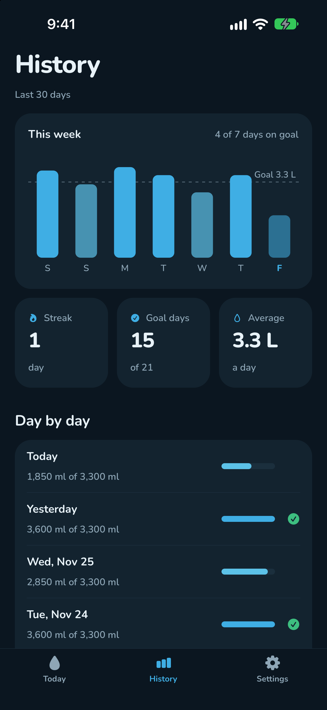
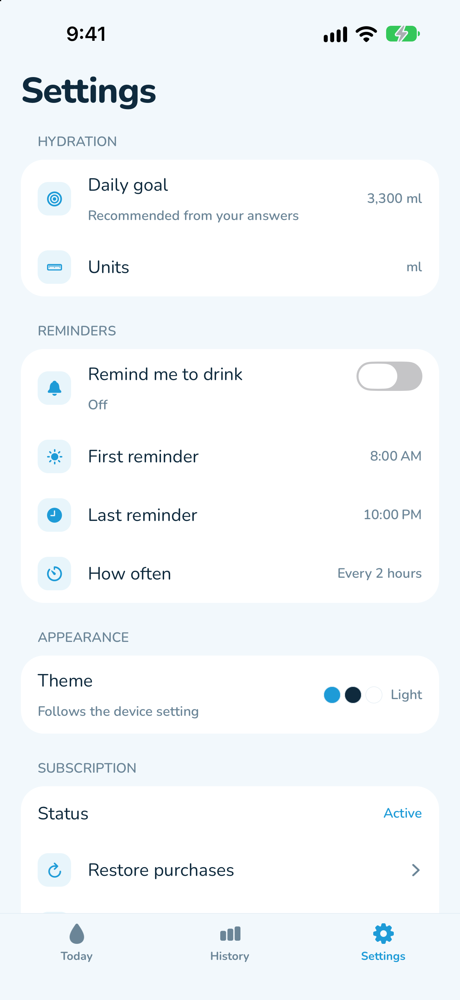

# Sipwell — water reminder and tracker

Sipwell helps a person drink enough water every day. Three onboarding questions (weight, activity,
weather) become a personal daily goal; the home screen is a glass that fills as cups are logged
with one tap; reminders nudge through the day; a history shows the streak building. It is for
anyone who knows they should drink more and wants the lightest possible app to make it a habit.
Everything is stored on the device. No account, no backend.

## Why this niche

The cheapest app in the set to build, and it still pays. Waterllama sits at #118 Top Free in
Health & Fitness with 165K ratings on a $9.99 one-time unlock and makes about $100K/month
(Adapty); WaterMinder makes about $35K/month (ScreensDesign). A water app will not reach
habit-tracker money, but it converts on charm and ships in days. The core loop is simple: tap a
cup, fill the day's glass, get nudged until the goal is met.

| App | Price | Source |
|---|---|---|
| WaterMinder | $2.99/mo, $14.99–29.99/yr, 7-day trial | [App Store](https://apps.apple.com/us/app/water-tracker-by-waterminder/id653031147), [ScreensDesign](https://screensdesign.com/showcase/water-tracker-by-waterminder) |
| Waterllama | $0.99–3.99/mo, $8.99–19.99 one-time; ~$100K/mo | [App Store](https://apps.apple.com/us/app/water-tracker-waterllama/id1454778585), [Adapty](https://adapty.io/paywall-library/water-tracker-waterllama/) |
| Plant Nanny | $7.99/mo, $69.99/yr (Sparkful bundle); under $10K/mo | [App Store](https://apps.apple.com/us/app/plant-nanny-cute-water-tracker/id1424178757), [AppGoblin](https://appgoblin.info/apps/1424178757) |

Price pattern used here: $1.99/week, $19.99/year with a 7-day trial on the yearly plan (the
mock paywall shows these; real prices come from App Store Connect through RevenueCat).

## Features

- Onboarding: welcome, weight, activity, weather, then a "Your plan" step that computes the goal
  in front of the user (about 33 ml per kg plus allowances for activity and climate).
- Today: an SVG glass with quarter marks and an animated wave that fills to the day's level. Tap a
  cup on the shelf (five sizes and a custom amount) and a stream pours in, the level springs up, the
  water sloshes and settles, and a haptic "gulp" lands with it. The day's log animates each insert.
- History: a hand-drawn week chart against the goal line, streak / goal days / average tiles,
  and a day-by-day list for the last 30 days with per-day goal marks.
- Reminders: daily local notifications between a first and last reminder at a chosen interval,
  switched on from Settings (permission is asked there, never on first launch).
- Settings: daily goal (recommended or custom), units (ml or US oz), reminder window and
  interval, delete all drinks, plus the base rows (theme, subscription, legal, rate, contact).
- Hard paywall with a trial timeline, per-week price and savings computed from the plans;
  RevenueCat Paywalls when a key is configured, with a built-in mock without one.
- Light and dark palettes, Nunito type, SF Symbols on iOS.

Stack: Expo SDK 58, Expo Router, TypeScript, React Native StyleSheet, react-native-svg,
react-native-reanimated, react-native-gesture-handler, expo-sqlite, expo-notifications,
RevenueCat.

## Screens

| | | |
|---|---|---|
|  |  |  |
|  |  |  |
|  |  |  |

Every screen, empty states and dark mode included, is in `screenshots/`.

## Run it

You need a Mac with [Xcode](https://apps.apple.com/app/xcode/id497799835) and Node 22.

```bash
npm install
npx expo run:ios
```

This app uses native modules (SVG, reanimated, gesture handler, SF Symbols, notifications), so it
runs in a development build, not Expo Go. The first `expo run:ios` compiles that build; after
that `npx expo start` is enough. Without a RevenueCat key the app uses the built-in paywall and a
mock purchase, so you can click through onboarding → paywall → tabs right away. In Settings there
are development-only rows: "Load sample data" fills three weeks of drinks for screenshots, and
"Reset app" goes back to the first launch.

## Connect RevenueCat

1. Create a project at [app.revenuecat.com](https://app.revenuecat.com) and add your iOS app
   (bundle id must match `ios.bundleIdentifier` in `app.json`).
2. In App Store Connect create two auto-renewable subscriptions (weekly and yearly) in one
   subscription group. Give the yearly one a 7-day free introductory offer, or set `trial.days`
   to `0` in `src/config/paywall.ts`. Add both products to RevenueCat.
3. In RevenueCat create an entitlement with the identifier `pro` and attach both products.
4. Create an offering and make it the **default**. Add two packages: **Weekly** (`$rc_weekly`)
   and **Annual** (`$rc_annual`) and attach the matching products.
5. Design a paywall for that offering in RevenueCat → Paywalls and publish it, or keep the
   built-in one by setting `ui: 'custom'` in `src/config/paywall.ts`.
6. Copy the iOS public API key (starts with `appl_`) and put it in a `.env` file:

   ```bash
   cp .env.example .env
   # EXPO_PUBLIC_REVENUECAT_IOS_KEY=appl_xxx
   ```

7. Rebuild: `npx expo run:ios`. Purchases are now real (sandbox while testing).

## Rebrand

One command renames the app, slug, bundle id and brand color:

```bash
node scripts/rebrand.mjs --name "Gulp" --slug gulp --bundle com.yourname.gulp --color "#1E9BD7"
```

Then replace the images in `assets/` (`icon.png` 1024×1024, `splash-icon.png`, and the three
Android icon layers) and edit `src/config/app.ts` (support email, terms and privacy URLs). The
rest of the palette lives in `src/theme/theme.ts`; the wave color is `colors.secondary`.

### Prompt for Claude Code or Cursor

Paste this into your AI coding agent, in the app folder, and fill in the angle brackets:

> Rebrand this water reminder app. Read README.md and AGENTS.md first.
> 1. Run `node scripts/rebrand.mjs --name "<App Name>" --slug <app-slug> --bundle <com.company.app> --color "<#hex>"`.
> 2. In `src/theme/theme.ts` adjust `secondary`, `background` and the dark palette so they sit well with the new accent. Keep the type scale.
> 3. Rewrite the copy in `src/config/onboarding.ts` in the voice of `<brand>`; keep the step ids and the option ids (`src/features/hydration/goal.ts` maps them to the goal).
> 4. Rewrite the headline, subheadline and benefits in `src/config/paywall.ts`. Keep the plan ids, package ids and the `{goal}`, `{start}`, `{end}` placeholders.
> 5. Set the support email and legal URLs in `src/config/app.ts`.
> 6. Optional: change the cup sizes in `cupPresets` in `src/features/hydration/goal.ts`, and the reminder copy in `src/features/hydration/reminders.ts`.
> 7. Finish with `npx tsc --noEmit`, `npx expo-doctor` and `npx expo export --platform ios`, all clean. No TODOs, placeholder text or unused code.

## Ship it

1. Create an [Apple Developer](https://developer.apple.com/programs/) account ($99/year) and an
   [Expo](https://expo.dev) account.
2. Install EAS: `npm install -g eas-cli`, then `eas login` and `eas build:configure`.
3. Put your RevenueCat key in EAS so the production build has it:
   `eas env:create --name EXPO_PUBLIC_REVENUECAT_IOS_KEY --value appl_xxx --environment production`
4. Build: `eas build --platform ios --profile production`. EAS creates the certificates for you.
5. In [App Store Connect](https://appstoreconnect.apple.com) create the app with the same
   bundle id, fill in the listing (screenshots, description, privacy policy URL, the two
   subscriptions), then `eas submit --platform ios` uploads the build.
6. Test the paywall with a Sandbox tester account, then submit for review. Apple asks for a
   terms-of-use link in the app description for subscription apps; `src/config/app.ts` holds
   the same URL used inside the app.

## Folder map

```
app/                      Routes. Thin files that render a screen from src/features.
  _layout.tsx             Root: loads Nunito, hydrates state, decides onboarding → paywall → tabs
  paywall.tsx             RevenueCat paywall, or the built-in one without a key
  (onboarding)/           index (step 0) and [step] (1..n)
  (tabs)/                 Today, History, Settings
src/
  components/             Screen, LargeTitleScroll, Button, Card, ListRow, Icon, Sheet,
                          OptionSheet, ProgressBar, CountUpText, EmptyState, Text
  config/                 app.ts, onboarding.ts, paywall.ts
  db/                     index.ts (open + migrate), migrations.ts, drinks.ts, dayGoals.ts
  features/
    hydration/            TodayScreen, HistoryScreen, WaterGlass (the hero), WeekChart,
                          AmountSheet, CupIcon, illustrations, goal (math + units), settings
                          (AsyncStorage store), reminders (notifications), stats, dates,
                          useToday, useGoal, sampleData (dev only)
    onboarding/           OnboardingScreen, PlanStep
    paywall/              CustomPaywall
    settings/             SettingsScreen
  purchases/              getEntitlement / purchase / restore; RevenueCat or mock behind it
  state/appState.ts       Persisted store: onboardingDone, answers, entitled
  theme/theme.ts          Palette (light + dark), spacing, radii, Nunito type scale; useTheme()
scripts/rebrand.mjs       Rename app, slug, bundle id, brand color
assets/                   Icon, splash image, Android icon layers
screenshots/              The screens above
DESIGN-NOTES.md           Palette, type scale, the signature interaction, critique rounds
```

Tables: `drinks` (id, day, amount_ml, logged_at) and `day_goals` (day, goal_ml), created by
migration 1 in `src/db/migrations.ts`.

## Checks and notes

```bash
npx tsc --noEmit                 # types
npx expo-doctor                  # dependencies and config
npx expo export --platform ios   # the app bundles
```

- Reminders are repeating daily local notifications scheduled on the device; they are
  re-scheduled on launch and whenever the reminder settings change. iOS allows 64 pending
  notifications, so the window and interval options keep the count under 20.
- `expo-dev-client` is a dependency so the app opens in a development build; it has no imports.
  `react-dom` is pinned only to satisfy Expo Router's dependency tree with npm; the app has no
  web target.
- `supportsTablet` is `false`, so App Store Connect only asks for iPhone screenshots.

## Ideas for version two

From the research's "leave out of version one": Apple Watch complications, caffeine and alcohol
adjustments to the goal, and social features (friends, challenges). Also natural next steps:
editable cup presets, a widget, and Health app export.
